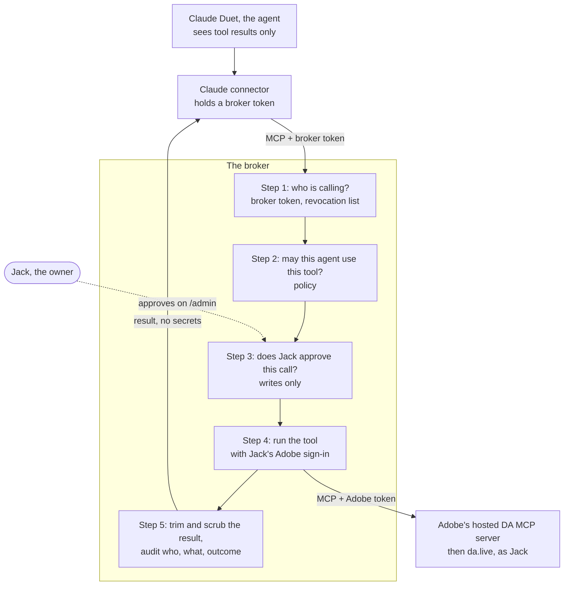
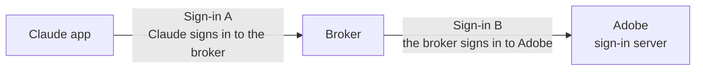
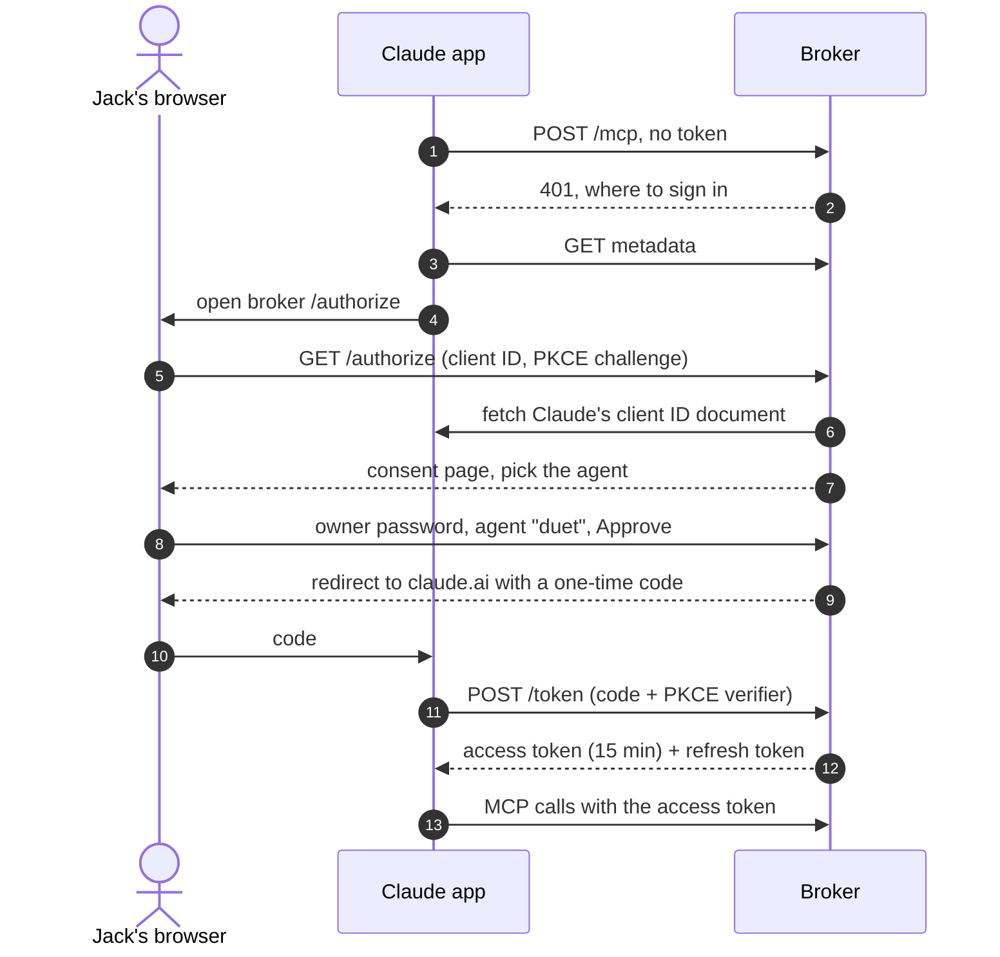
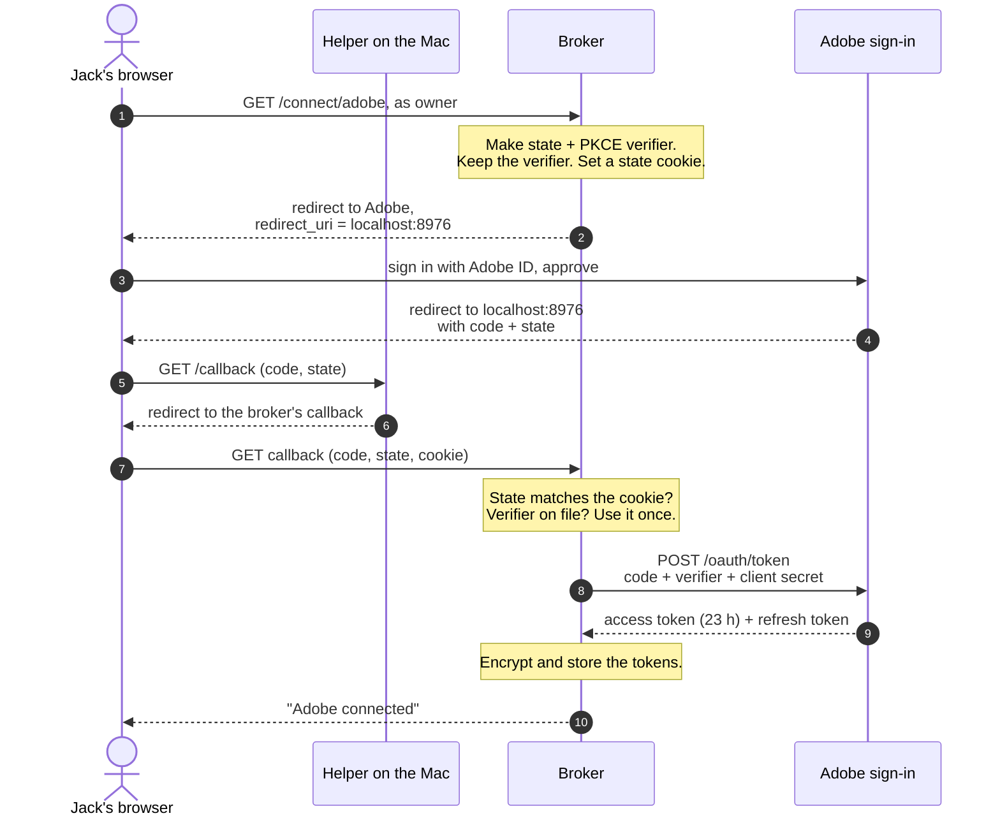
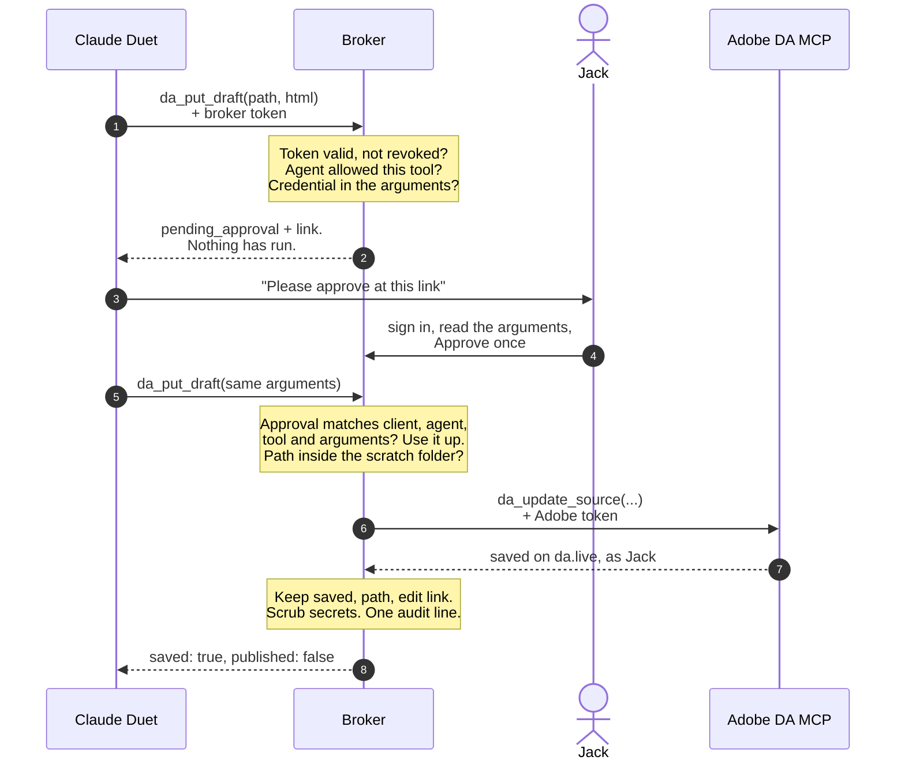
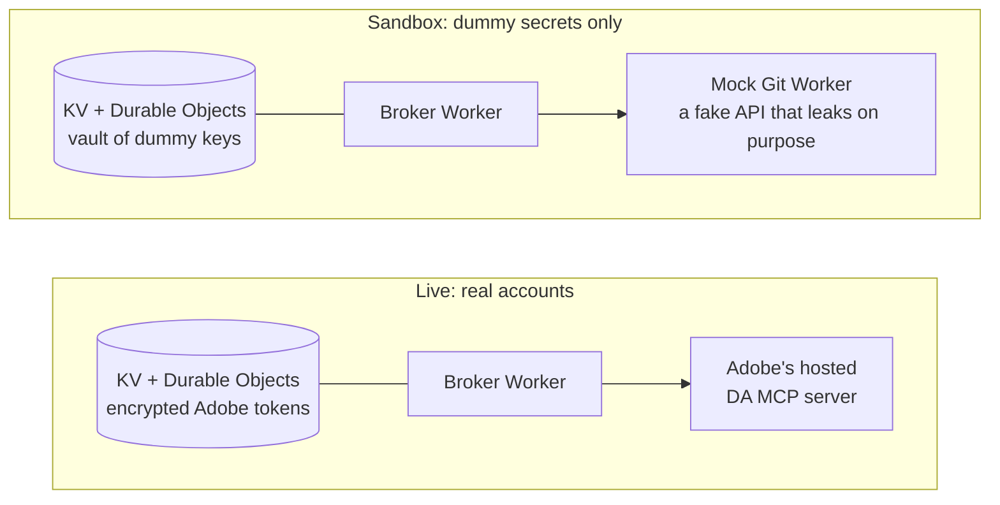

# Architecture

How the Agent Secrets Broker works, with diagrams. It is written to be read top to bottom by someone who knows what OAuth is but hasn't built with it, and it describes what is deployed as of 2026-11-13.

For what was tested and what failed, see [findings.md](findings.md). For the evidence, see [test-log.md](test-log.md).

## The problem

AI agents need to use accounts and API keys, and most of them have no safe place to keep one. Claude Duet is the strictest case:

- it has no vault,
- it won't accept a key pasted into chat,
- anything a tool returns lands in the model's context, so it can't "fetch a secret and not read it".

So the agent must never hold the secret at all. Something else has to hold it and make the call.

## The idea in one picture

The broker sits between the agent and the service. The agent asks for an outcome ("save this draft"). The broker checks whether that agent may ask, gets the owner's approval if the call is sensitive, makes the call with credentials only it holds, and returns a trimmed result.

Three things in that picture carry most of the design:

- **Two different tokens, and the agent holds neither.** The Claude app holds a *broker* token on the agent's behalf. The broker holds an *Adobe* token. The model sees only tool results.
- **Tools are shaped like tasks.** There is `da_put_draft`, not `get_token` or `call_any_api`. No tool returns a secret, and the agent can't choose what the broker calls upstream.
- **The owner is a separate channel.** Jack approves on the broker's own admin page with his own password. The agent can ask; it can't approve.

## Two sign-ins, facing opposite ways

This is the part that is easy to get confused about. The broker takes part in **two separate OAuth sign-ins**, and it plays a different role in each.

| | Sign-in A: Claude to broker | Sign-in B: broker to Adobe |
|---|---|---|
| Who is the client | The Claude app | The broker |
| Who issues tokens | The broker | Adobe |
| How Jack approves | The broker's consent page, owner password, picks the agent | Adobe's own sign-in page, his Adobe ID |
| What the token allows | Calling the broker's tools as agent `duet` | Acting on da.live as Jack |
| Access token lifetime | 15 minutes | 23 hours |
| Refresh | Yes, rotates on use, 30 days | Yes |
| Where the token lives | In the Claude app | In the broker, encrypted |

Both use the same pattern, the **authorization code flow with PKCE**:

1. The client sends the user's browser to the authorization server.
2. The user signs in and approves there.
3. The browser comes back to the client carrying a short-lived, single-use **code**.
4. The client swaps the code for tokens, server to server.

The point of step 4 is that tokens never travel through the browser. The next two sections walk through each sign-in.

## Sign-in A: connecting Claude to the broker

Jack does this once, in claude.ai, by adding the broker's `/mcp` URL as a custom connector.

What to notice:

- **Step 6, how the broker knows it is really Claude.** Claude's client ID is a URL (`https://claude.ai/oauth/mcp-oauth-client-metadata`). The broker fetches that document from claude.ai itself and reads the app's name and callback address from it. That is why the consent page can say "Published by claude.ai" and mean it.
- **Step 8, the grant is bound to an agent.** Jack picks which agent this connection is. Every later call through this connection gets exactly that agent's tools.
- **The client ID identifies the app, not the person or the agent.** Every Claude user in the world presents the same ID. So "duet" really means "any Claude on Jack's account that has this connector". A Claude Code session came back as `duet` too.
- **One connection per app.** A second approval for the same client ID replaces the first. The consent page warns before it does.

## Sign-in B: the broker signs in to Adobe, through localhost

This is the interesting one. The broker needs to act on da.live as Jack, with Jack's own permissions, not as a service account.

### Why it needs a trick

- **Adobe's Developer Console wouldn't issue a user sign-in credential.** For the APIs that fit da.live it offered Jack's org only server-to-server credentials, which act as a technical account, not as Jack.
- **Adobe's own hosted MCP server for DA does sign users in.** It has its own sign-in server, which registers new clients on request, but only for callback addresses it already knows.
- **The broker's address was refused; localhost was accepted.** Local tools like Cursor use `http://localhost` callbacks, so Adobe allows those.

A localhost callback normally means "the app runs on your computer". The broker runs in Cloudflare. The trick is to let the browser's redirect land on Jack's Mac, and have a tiny local helper pass it straight on to the broker.

### The flow

### Who swaps the code for the token?

**The broker does, in step 8**, talking to Adobe directly. Nothing else can:

| To get tokens you need | Who has it |
|---|---|
| The one-time code | Passes through the browser and the helper |
| The PKCE verifier (the secret half of the challenge sent in step 2) | Only the broker |
| The client secret Adobe issued at registration | Only the broker |

So the helper on the Mac sees only the code, and the code alone is worthless. It is single use, it expires in minutes, and Adobe will only exchange it for whoever also presents the verifier and the client secret. The tokens come back in step 9 on a direct connection between the broker and Adobe. They never touch the Mac or the browser.

### What each safeguard is for

- **PKCE.** In step 2 the broker sends a hash (the challenge). In step 8 it sends the original value (the verifier). Adobe checks that they match. Someone who steals the code in transit can't use it.
- **State, tied to a cookie.** The broker checks that the sign-in coming back is the one this browser started. That stops an attacker from feeding their own Adobe code into Jack's broker.
- **Owner session on step 1.** Only Jack can start connecting an Adobe account.
- **Encryption at rest.** The tokens are stored AES-GCM-encrypted under a key that exists only as a Worker secret.

### What the helper is

About 20 lines of Node (`npm run live -- adobe-connect`). It listens on `localhost:8976`, and when the browser arrives at `/callback` it answers with a redirect to the same path on the broker, query string unchanged. It stores nothing and prints nothing from the request.

### Caveats

- **Reconnecting needs the Mac.** A fresh Adobe sign-in only works from a machine running the helper. Day to day this doesn't matter: the broker refreshes its own tokens.
- **The registration is unofficial.** The broker rides on a callback address Adobe allows for local tools. The supported route for a hosted client is to ask Adobe to allowlist it.
- **Adobe's token is a wrapper.** It contains Jack's real Adobe sign-in, encrypted by Adobe. The broker can use it but can't open it. Adobe sends no ID token, name or email. After the first refresh the wrapper does carry a stable Adobe user ID (`sub`), which is enough to key roles on but not to show a name ([findings](findings.md#who-signed-in-what-adobe-tells-the-broker)).

## A tool call, end to end

What happens when Duet is asked to save a draft. This is the path Claude Duet ran on 2026-11-13.

The checks, in the order they run:

| Check | What it stops |
|---|---|
| **Broker token** (15 minutes, bound to one connection) | Anyone without a connection Jack approved |
| **Revocation list** (strongly consistent) | A connection Jack has cut off, immediately |
| **Policy** (agent to tools) | An agent calling a tool it wasn't given; the tool isn't even listed for it |
| **Credential in arguments** | A fooled agent posting its own token or a key out through a tool |
| **Per-call approval** (writes) | A write Jack didn't intend; he sees the exact arguments |
| **Scratch-folder path rules** | Touching anything outside `drafts/sites-ai-webinar` |
| **Fixed upstream call** | The agent reaching Adobe's delete, move, preview or publish tools |
| **Allow-listed result, then redaction** | A token or key coming back in a result |
| **Audit line** (who, tool, outcome; never arguments or content) | Not knowing what happened afterwards |

Reads (`da_list`, `da_get`) take the same path without the approval step. Text they return from da.live is marked `untrusted_content`, because a document can contain instructions aimed at the agent.

## Where every secret lives

The most useful single table for reasoning about what a compromise would cost.

| Secret | Where it lives | Who can use it | Who never sees it |
|---|---|---|---|
| Broker access and refresh tokens | The Claude app | Any Claude on Jack's account with the connector | The model; the broker stores only hashes |
| Owner password | Jack's head and password manager; a Worker secret | Jack | Everyone else, including the broker's scripts |
| Adobe client secret | A Worker secret, piped in at registration | The broker | Jack, Claude, the repo, logs |
| Adobe access and refresh tokens | Broker KV, AES-GCM encrypted | The broker's three DA tools | The agent, the Claude app, Jack's Mac, logs |
| Token encryption key | A Worker secret, generated and piped in | The broker | Everyone |
| Admin API token | A Worker secret and a gitignored file on Jack's Mac | Scripts: read the audit log, revoke | It can't approve tool calls or connections |
| The one-time Adobe code | In transit for a few seconds: browser, helper, broker | Nobody without the verifier and client secret | - |

## What runs where

One Cloudflare Worker is both the OAuth server for sign-in A and the MCP server. There are two deployments of the same code.

- **Sandbox** (`agent-secrets-broker-sandbox`) proves the mechanisms with fake secrets and a fake upstream that leaks on purpose (it echoes keys in errors and embeds them in content), so the tests can show the broker strips them. The automated end-to-end test runs here.
- **Live** (`agent-secrets-broker-live`) holds the real Adobe sign-in. Real secrets never go in the sandbox, and nothing shares state between the two.
- **KV for bulk state, Durable Objects for decisions.** KV is eventually consistent: a listing can lag by up to a minute. That is fine for an audit log and wrong for "is this approval still unused?" or "was this connection revoked?". Those two live in Durable Objects, which are strongly consistent. This split came from a real failure: a revoke that missed a connection made seconds earlier.

## Why not connect Claude straight to Adobe?

Claude can add Adobe's DA MCP server as a connector directly, and for many uses that is the right answer: the Claude app holds the token and Adobe applies Jack's permissions. The broker is worth its complexity only for what it adds:

| | Direct to Adobe's MCP server | Through the broker |
|---|---|---|
| Agent sees a token | No | No |
| Acts with Jack's permissions | Yes | Yes |
| Limit to one folder | No, everything Jack can reach | Yes |
| Approve each write | No | Yes |
| Delete, move, publish available | Yes | No |
| One audit log across agents and services | No | Yes |
| Different tools per agent | No | Yes |
| Works for services with no MCP server or OAuth | No | Yes, with an API key in the broker |

## Lessons that cost something to learn

- **A scripted pass is not a browser pass.** Two bugs passed every scripted test and failed for Jack: an origin check that real browsers trip (`Origin: null` from a no-referrer page), and a `__Host-` cookie with the wrong path that browsers drop silently.
- **Eventual consistency shows up as security bugs.** Revoke, "one connection per app" and single-use approvals all needed strongly consistent storage.
- **The client ID is the app.** It can't tell users or agents apart. Identity per agent needs the agent to prove something only it has.
- **A test that signs in as the real app can evict the real user.** The end-to-end test once replaced Jack's own connection. It now refuses to approve when a real connection exists.
- **The provider's developer console is not the whole story.** Adobe's console said "server-to-server only"; Adobe's own MCP server offered user sign-in.
- **Approving everything is too much.** Three approvals for list, read and write took two and a half minutes. Approval is now on writes only.
